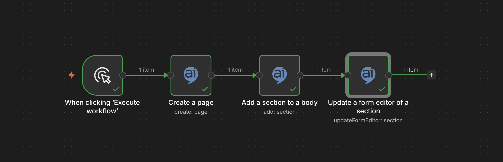
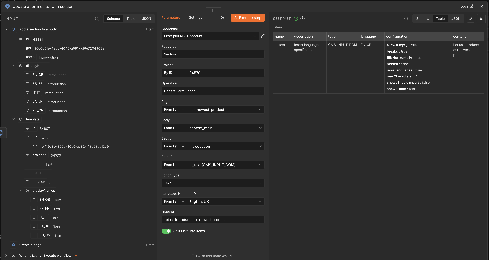

# n8n-nodes-firstspirit

> **Recommended for development and testing while in beta.** This node is built for FirstSpirit REST API
> version 0.0.25-beta. As the API continues to evolve, both the API and this node's operations, parameters
> and behaviour may change without prior notice. Production use is not recommended at this stage.

## Overview

This repository provides a custom n8n integration node for the FirstSpirit REST API. It enables direct access to FirstSpirit content and configuration from within an n8n workflow: projects, pages, page references, media, sections, datasets and data sources, global content, templates, scripts, modules and search.

## What is it?

A n8n node module designed to simplify integration with the FirstSpirit REST API using basic auth credential management. It supports:

- Authentication using username/password
- Read and manage projects, pages, page references, sections and media
- Read and edit form content of pages, sections, datasets and global content
- Manage data sources and datasets
- Manage templates (page, section, format, link), schemas, scripts and modules
- Search elements by ID, UID and references
- Chain operations using dynamic expressions for automated content data pipelines

## What is it for?

This module is useful for organizations looking to build automated content pipelines into the FirstSpirit ecosystem.

---

## Supported Resources & Operations

<!-- resources:start -->

The node covers 159 operations across 18 resources.

<!-- prettier-ignore -->
| Resource | Covers | Operations |
|---|---|---|
| Data Source | Data sources of a project | 3 |
| Dataset | Datasets of a data source, including form editors and revisions | 10 |
| Document Group | Document groups for page references | 3 |
| Folder | Page, page reference and media folders: read and rename | 6 |
| Format Template | Format templates and their channel sources | 7 |
| Global Content | Global content pages with bodies, sections, form editors and project properties | 14 |
| Link Template | Link templates with GOM, rules and channel sources | 12 |
| Media | Media with binary data, resolutions, revisions, usages and actions | 13 |
| Module | FirstSpirit modules: list, read, install and delete | 4 |
| Page | Pages with bodies, form editors, metadata, revisions, usages and actions | 17 |
| Page Reference | Page references with settings, revisions and actions | 10 |
| Page Template | Page templates with bodies, GOM, rules and channel sources | 16 |
| Project | Projects with their languages, resolutions, settings and template sets | 10 |
| Schema | Schemas (read only) | 2 |
| Script | Scripts with code, GOM and execution | 9 |
| Search | Search by text, element ID or UID, and for external and invalid references | 5 |
| Section | Sections of a page body with form editors | 6 |
| Section Template | Section templates with GOM, rules and channel sources | 12 |

<!-- resources:end -->

Choose the resource and then the operation in the node. Each operation maps to one endpoint of the
[FirstSpirit REST API](https://docs.crownpeak.com/restapi/); the mapping is defined in
`nodes/FirstSpiritRestApi/operations.ts`. Each method supports query parameterization using dynamic expressions and authenticates using Basic Auth.

## Prerequisites

The node talks to the FirstSpirit REST API, which is provided by a FirstSpirit REST module. How you
get it depends on how your FirstSpirit is operated.

> Warning: The FirstSpirit REST API is in **beta** and **under active development**.
>
> Functionality, APIs, and compatibility are subject to change without notice.
> **Do not use in production environments**.

**On-premises**

- **FirstSpirit**: a current FirstSpirit version
- **Application server**: standalone Apache Tomcat
- **FirstSpirit REST module**: [Download](https://artifactory.e-spirit.hosting/ui/native/repo/com/crownpeak/firstspirit/modules/fs-rest-service/0.0.25-beta/fs-rest-service-0.0.25-beta.fsm) and install the FirstSpirit REST API module (version 0.0.25-beta)
  The download requires a login to the FirstSpirit Artifactory, which FirstSpirit customers have.

See the [FirstSpirit REST API documentation](https://docs.crownpeak.com/restapi/) for the API and for
setup and configuration of the module.

> Note: To enable communication, the FirstSpirit server must be made accessible to n8n, for example by using a tunneling tool such as ngrok.

**Cloud**

- The FirstSpirit REST module is not available for self-installation. You can request to join the
  open beta; the module is then provided on your own cloud instance.

## Installation

### As a Community Node

1. In n8n, open **Settings → Community Nodes** and choose **Install**.
2. Enter the package name `n8n-nodes-firstspirit`, accept the risk notice and install.
3. The node appears as **FirstSpirit REST API** in the node panel.

See the [n8n documentation on community nodes](https://docs.n8n.io/integrations/community-nodes/installation/gui-install/)
for details and for installing on instances where this option is not available.

### As a Private Node

This installs the node from a package built from this repository into an n8n Docker container.

1. Clone this repository and build the package (Node.js 20.15 or higher is required):
   ```sh
   git clone https://github.com/e-Spirit/n8n-nodes-firstspirit.git
   cd n8n-nodes-firstspirit
   npm install
   npm run build
   npm pack
   ```
   This creates `n8n-nodes-firstspirit-<version>.tgz` in the current directory.
2. Start the n8n Docker container:
   ```sh
   docker run -d \
    --name n8n \
    -p 5678:5678 \
    -v n8n_data:/home/node/.n8n \
    docker.n8n.io/n8nio/n8n
   ```
3. Copy the package into the container and install it into n8n's nodes directory:
   ```sh
   docker cp n8n-nodes-firstspirit-*.tgz n8n:/tmp/
   docker exec -u node n8n sh -c "mkdir -p ~/.n8n/nodes && cd ~/.n8n/nodes && npm install --legacy-peer-deps /tmp/n8n-nodes-firstspirit-*.tgz"
   ```
   `--legacy-peer-deps` is needed because n8n already provides `n8n-workflow`; without it the install
   tries to build it again and fails.
4. Restart the n8n Docker container:
   ```sh
   docker restart n8n
   ```
5. Log in to n8n and the node will appear as FirstSpirit REST API.

> Note: If it doesn't appear, check `docker logs n8n` for errors while loading the node.

To update the node, build a new package and repeat steps 3 and 4.

## Usage

1. Create a **FirstSpirit API** credential (see [Credentials](#credentials)) and run its **Test** button.
2. Add the **FirstSpirit REST API** node to a workflow, then choose a resource and an operation.
3. Fields that refer to FirstSpirit elements (project, page, data source and so on) offer a searchable
   dropdown filled from your server. You can also switch a field to an expression to map values from
   previous nodes.
4. List operations can return all results or stop at a limit. The node walks through the pages of the
   API for you.

A typical pipeline reads content (for example **Page → Get Form Editor**), transforms it in other n8n
nodes and writes it back (**Section → Update Form Editor**). See the screenshots below.

### Example workflow

The workflow below creates a page, adds a section to its body and fills a form editor of that section,
as shown in the screenshots. To try it, copy the JSON, paste it onto an empty n8n canvas (Ctrl+V or
Cmd+V), select your **FirstSpirit API** credential on the three FirstSpirit nodes and replace every
`REPLACE_WITH_...` value with a value from your own project. Run it against a test project, because it
writes content.

<details>
<summary>Workflow JSON</summary>

```json
{
  "name": "FirstSpirit: create a page and fill a form editor",
  "nodes": [
    {
      "parameters": {},
      "name": "When clicking 'Execute workflow'",
      "type": "n8n-nodes-base.manualTrigger",
      "typeVersion": 1,
      "position": [
        0,
        0
      ]
    },
    {
      "parameters": {
        "resource": "page",
        "operation": "create",
        "projectId": {
          "mode": "id",
          "value": "REPLACE_WITH_PROJECT_ID"
        },
        "body": "{\"uid\":\"REPLACE_WITH_NEW_PAGE_UID\",\"templateUid\":\"REPLACE_WITH_PAGE_TEMPLATE_UID\"}"
      },
      "name": "Create a page",
      "type": "n8n-nodes-firstspirit.firstSpiritRestApi",
      "typeVersion": 1,
      "position": [
        240,
        0
      ],
      "credentials": {
        "firstSpiritApi": {
          "id": "REPLACE_WITH_CREDENTIAL_ID",
          "name": "FirstSpirit API"
        }
      }
    },
    {
      "parameters": {
        "resource": "section",
        "operation": "add",
        "projectId": {
          "mode": "id",
          "value": "REPLACE_WITH_PROJECT_ID"
        },
        "pageUid": {
          "mode": "id",
          "value": "REPLACE_WITH_NEW_PAGE_UID"
        },
        "bodyName": {
          "mode": "id",
          "value": "REPLACE_WITH_BODY_NAME"
        },
        "sectionName": "REPLACE_WITH_SECTION_NAME",
        "body": "{\"templateUid\":\"REPLACE_WITH_SECTION_TEMPLATE_UID\"}"
      },
      "name": "Add a section to a body",
      "type": "n8n-nodes-firstspirit.firstSpiritRestApi",
      "typeVersion": 1,
      "position": [
        480,
        0
      ],
      "credentials": {
        "firstSpiritApi": {
          "id": "REPLACE_WITH_CREDENTIAL_ID",
          "name": "FirstSpirit API"
        }
      }
    },
    {
      "parameters": {
        "resource": "section",
        "operation": "updateFormEditor",
        "projectId": {
          "mode": "id",
          "value": "REPLACE_WITH_PROJECT_ID"
        },
        "pageUid": {
          "mode": "id",
          "value": "REPLACE_WITH_NEW_PAGE_UID"
        },
        "bodyName": {
          "mode": "id",
          "value": "REPLACE_WITH_BODY_NAME"
        },
        "sectionName": "REPLACE_WITH_SECTION_NAME",
        "editorName": {
          "mode": "id",
          "value": "REPLACE_WITH_EDITOR_NAME"
        },
        "language": {
          "mode": "id",
          "value": "REPLACE_WITH_LANGUAGE"
        },
        "body": "{\"name\":\"REPLACE_WITH_EDITOR_NAME\",\"type\":\"CMS_INPUT_TEXT\",\"content\":\"Hello from n8n\"}"
      },
      "name": "Update a form editor of a section",
      "type": "n8n-nodes-firstspirit.firstSpiritRestApi",
      "typeVersion": 1,
      "position": [
        720,
        0
      ],
      "credentials": {
        "firstSpiritApi": {
          "id": "REPLACE_WITH_CREDENTIAL_ID",
          "name": "FirstSpirit API"
        }
      }
    }
  ],
  "connections": {
    "When clicking 'Execute workflow'": {
      "main": [
        [
          {
            "node": "Create a page",
            "type": "main",
            "index": 0
          }
        ]
      ]
    },
    "Create a page": {
      "main": [
        [
          {
            "node": "Add a section to a body",
            "type": "main",
            "index": 0
          }
        ]
      ]
    },
    "Add a section to a body": {
      "main": [
        [
          {
            "node": "Update a form editor of a section",
            "type": "main",
            "index": 0
          }
        ]
      ]
    }
  },
  "pinData": {},
  "settings": {
    "executionOrder": "v1"
  }
}
```

</details>

### Uploading and downloading binary data

- **Download:** **Media → Get Binary Data** (and the resolution variant) writes the file into the
  binary property named in **Binary Property** (default `data`) of the output item. Later nodes such as
  *Write Binary File* can use it.
- **Upload:** **Media → Upload Binary Data** and **Module → Install** read the file from the binary
  property named in **Binary Property** (default `data`) of the incoming item. Produce the binary data
  with a node such as *HTTP Request* or *Read Binary File* before the FirstSpirit node.

---

## Screenshots

Click an image to view it in full size.

### A basic workflow

A basic workflow example using the n8n FirstSpirit REST API node.

<a href="https://raw.githubusercontent.com/e-Spirit/n8n-nodes-firstspirit/main/images/screenshots/basic-workflow-example-1.png">
  
</a>

### Updating a form editor

The `Update Form Editor` operation of a section and its result.

<a href="https://raw.githubusercontent.com/e-Spirit/n8n-nodes-firstspirit/main/images/screenshots/basic-workflow-example-2.png">
  
</a>

---

## Credentials

This node supports authentication against the FirstSpirit REST API. You'll need the following credentials:

- Username and Password
- Base URL of the FirstSpirit REST API — the server URL **plus the REST context path**, for example
  `https://your-server.example.com/rest`. The browser URL of the server alone is not enough: every
  operation path starts at `/v1/...` below that base, so a missing `/rest` makes every request 404.

Authentication is **Basic Auth only**. The FirstSpirit REST API also accepts Bearer (JWT) tokens;
this node deliberately does not support them.

Use the credential's **Test** button to check the values before building a workflow; it performs a
`GET /v1/projects/` against the base URL.

---

## Development

```sh
npm install
npm run build        # compile to dist/
npm test             # unit tests
npm run lint
npm run format
npm run dev          # build in watch mode and start a local n8n with the node loaded
```

Node.js 20.15 or higher is required. `npm run dev` starts n8n through `npx n8n@latest`, which may
require a newer Node.js version than the package itself.

### Versioning

The node version is the version of the FirstSpirit REST API it is built for, for example `0.0.25-beta`.
A fix that only changes the node adds a counter (`0.0.25-beta.1`, `0.0.25-beta.2`). The next API
release starts a new version (`0.0.26-beta`). Always install the REST module in the API version the
node is built for.

The operations are defined as data in `nodes/FirstSpiritRestApi/operations.ts`, and the editor UI
for them in `nodes/FirstSpiritRestApi/descriptions/`. If you add or change an operation, adjust the
operation counts in the overview above.

---

## Support

- This repository is released under the MIT License.
- For n8n integration issues or pull requests, use GitHub Issues or Discussions.

## License

MIT (c) Rezolve AI
See [LICENSE](https://github.com/e-Spirit/n8n-nodes-firstspirit/blob/main/LICENSE) for details.
